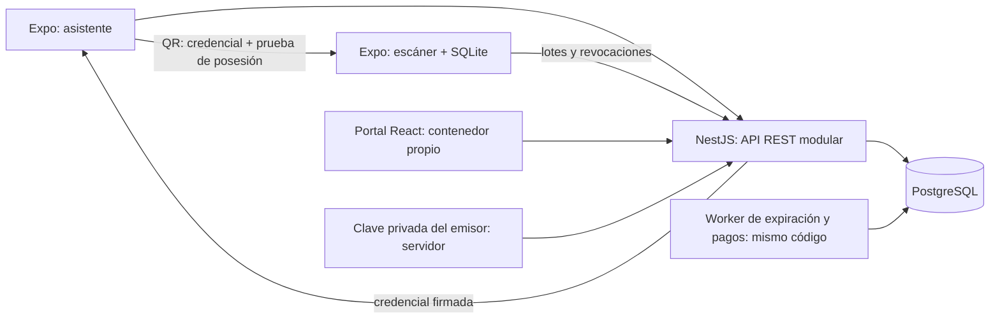

# Arquitectura propuesta — Fase 1

**Estado: diseño inicial, no implementación; pendiente de contrastar con
`enunciado.html`.** La dirección técnica fija NestJS, PostgreSQL, React Native,
Expo y un portal separado. No existe código previo reutilizable.

## Componentes



El worker comparte módulos y base de datos del monolito; no constituye un
microservicio de negocio. No se propone Redis. PostgreSQL conserva inventario,
sesiones, reservas, pagos, tickets, revocaciones, accesos e historial.

Estructura prevista:

```text
apps/api/              módulos NestJS, migraciones y worker
apps/admin/            React + TypeScript, interfaz administrativa
apps/mobile/           Expo + TypeScript, asistente y escáner
packages/contracts/    contratos y tipos compartidos, sin secretos
packages/shared/       funciones puras compartidas cuando sean necesarias
infra/docker/          construcción y arranque
tests/integration/     PostgreSQL real y escenarios API
tests/load/            carga concurrente reproducible
docs/                  decisiones, QA y progreso
```

Se propone un workspace npm con lockfile, versiones fijadas al validar la
compatibilidad y TypeScript estricto. La librería SQL y las versiones de Expo,
NestJS y PostgreSQL se elegirán tras revisar el enunciado y el spike móvil; no
hay manifiestos ni dependencias instaladas todavía.

## Módulos y autoridad

| Módulo | Responsabilidad |
|---|---|
| Identity | Registro, contraseña, sesiones, refresh rotativo y logout |
| Authorization | Roles y alcance por evento/recurso; comprobación en cada operación |
| Events | Eventos, zonas, puertas, fases y asignaciones de staff |
| Reservations | Precio del servidor, aforo, límite por cuenta y expiración |
| Payments | Pago/reembolso simulado con máquina de estados idempotente |
| Tickets | Emisión, titularidad, transferencia, anulación y credenciales |
| Access | Un ingreso lógico, intentos persistidos e incidentes |
| Sync | Dispositivos, lotes idempotentes y revocaciones incrementales |
| Audit | Registro de actor, motivo y transiciones en la misma transacción |
| Reporting | Consultas autorizadas para el portal, paginación y reconciliación |

Los controladores validan DTO, autenticación y permisos; los servicios de dominio
aplican reglas; las transacciones contienen todas las escrituras relacionadas.
El móvil nunca decide precio, autorización administrativa ni inventario.

## Flujos críticos

1. **Reserva:** autenticar, validar payload y clave; obtener precio vigente del
   servidor; bloquear inventario y límite por cuenta; crear reserva e historial
   en una transacción. El servidor devuelve precio y expiración persistidos.
2. **Pago:** mismo payload/clave devuelve mismo resultado. Estado, cobro simulado,
   conversión de reserva y ticket se consolidan transaccionalmente. Una reserva
   vencida no puede emitir ticket; propuesta de reembolso tardío idempotente.
3. **QR:** API emite credencial ligada a clave pública del titular y versión de
   ticket. Móvil firma una prueba temporal con su propia clave. Escáner valida
   ambas firmas, evento, ventana temporal y revocaciones disponibles.
4. **Acceso offline:** validación y registro local atómicos en SQLite. El UUID se
   mantiene al reintentar sync. Los rechazos también se guardan. Un marcador
   local impide una segunda aceptación lógica en ese dispositivo.
5. **Sync:** el servidor autentica dispositivo/staff, conserva cada intento,
   arbitra un solo ingreso lógico por ticket y registra conflictos. Responde
   resultado por UUID y cursor de revocaciones; perder la respuesta es recuperable.

## Infraestructura prevista y datos

Compose tendrá PostgreSQL, job de migración/semilla, API, worker y portal. API no
declara readiness hasta tener DB y esquema listos. La semilla usa claves estables
y se ejecuta dos veces en validación. Los originales sensibles permanecen fuera
de Git; la carga aceptará una ruta privada explícita o fixtures sintéticos
sanitizados y documentados, sin reutilizar contraseñas originales.

`docker compose up` desde clon limpio exige que las semillas públicas puedan
generarse sin el archivo privado. Debe comprobarse contra el enunciado si se
requiere exactamente el dataset original; no se afirma haberlo cargado.

Los procesos no sobreviven necesariamente al snapshot del entorno. Cuando se
implemente el flujo se guardarán instalación y arranque comprobados en la
configuración de nube. Se usará el checkout aislado existente; no se necesita
crear un worktree. Ahora no se guardan scripts ficticios de una app inexistente.
