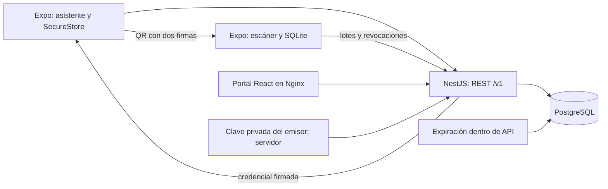

# Arquitectura de Ticketing y Control de Acceso

**Estado:** diseño adoptado y componentes implementados en esta rama. Su presencia no acredita pruebas: resultados ejecutados en `docs/qa/` y avances en `docs/progress/`. El enunciado fue recibido en la conversación; `docs/requirements/enunciado.md` conserva una síntesis identificada como tal, no el HTML original.

## Componentes



| Componente | Selección implementada | Responsabilidad |
|---|---|---|
| API | NestJS 11.2.7, TypeScript estricto, pg 8.16.3 | REST, autorización y transacciones |
| Datos | PostgreSQL 16 | Inventario, ledger simulado, sesiones y evidencia |
| Portal | React 19.1.0, Vite 7.3.7 | Administración desde API; contenedor independiente |
| Móvil | Expo 54.0.37, React Native 0.81.5 | Asistente, cámara, QR y escáner offline |
| Contratos | @hypernova/contracts compilado CommonJS | Tipos y protocolo Ed25519 compartido |
| Criptografía | @noble/curves 1.9.7, @noble/hashes 1.8.0 | Firma/verificación JS; sin importar Node en móvil |
| Persistencia móvil | Expo SQLite y SecureStore | Intentos/caché en SQLite; semillas privadas en SecureStore |

La API es autoridad para identidad, permisos, precios, compras, titularidad y reconciliación. PostgreSQL es la fuente de verdad de operaciones críticas. El monolito modular tiene módulos Auth, Events/Admin, Commerce, Access y Operations. No se añade Redis ni un servicio de cola. El portal usa datos de la API, y el móvil distingue caché local de estado confirmado.

```text
apps/api/              módulos NestJS, SQL y bootstrap
apps/admin/            portal React + TypeScript
apps/mobile/           Expo: asistente y escáner
packages/contracts/    protocolo y tipos, sin secretos
infra/data/            copia sanitizada del dataset
infra/docker/          construcción, Nginx y entrypoint
tests/                 integración y carga
docs/                  requisitos, arquitectura, ADR y QA
```

## Flujos y parámetros

1. **Reserva:** normalizar zona/cantidad y clave idempotente; bloquear zona, liberar vencidas y bloquear contador usuario/evento. Precio desde fase activa. Inventario, reserva y respuesta idempotente se confirman juntos. TTL predeterminado: 600 segundos.
2. **Pago:** zona y reserva bloqueadas; cargo simulado, compra, entradas y contadores en una transacción. Pago tardío registra `late_refund` una vez, sin emitir entradas.
3. **Transferencia:** propuesta pendiente; aceptación cambia titular, incrementa versión y revoca la anterior. Credencial del receptor requiere conexión para vincular su clave pública. Cancelación resuelve pendientes.
4. **Reembolso/anulación:** bloquear zona y ticket, revalidar uso/plazo/permisos, revocar y devolver cupo una sola vez. Conservar actor y motivo.
5. **QR:** servidor firma ticket/evento/zona/versión/clave del titular; móvil firma prueba para slot de 25 segundos. Se acepta slot actual y anterior: una captura puede valer menos de 50 segundos. No se aceptan slots futuros.
6. **Acceso local:** SQLite registra cada intento con UUID. Comprobación de aceptación previa e inserción ocurren en transacción exclusiva.
7. **Sync:** cada UUID se confirma por separado; reintentos devuelven decisión previa. Una admisión central por ticket/evento. Segundo aceptado offline conserva evidencia y genera incidente.

La expiración se barre cada segundo en el proceso API y se recupera al reservar/pagar; su fuente es SQL, no el temporizador. Disponibilidad pública usa caché de 500 ms por instancia y cuenta solo reservas aún vigentes: es una lectura informativa, no una promesa de compra. Toda reserva revalida inventario en DB.

## Arranque y semilla

Compose declara PostgreSQL, API, portal y job de secretos generados una vez en volumen privado. La API aplica migraciones y semilla bajo bloqueo DB antes de escuchar. Rol runtime no puede modificar auditoría ni historial de escáner. Healthchecks ordenan dependencias; readiness comprueba conexión a DB. El arranque completo solo queda probado al ejecutar Compose y comprobar sus servicios.

El original aportado permanece fuera de Git. `infra/data/seed-ticketing.json` conserva filas/referencias con identidades sanitizadas; no publica contraseñas originales. IDs de usuario `rol-id` evitan colisiones entre colecciones. Las fechas se desplazan por un delta común respecto de un anchor de primera carga persistido en `seed_metadata`; no se desplazan otra vez en cada arranque. Es una adaptación temporal para demostración, no una carga literal sin cambios del original. Ver `docs/qa/dataset.md`.

JWT, privada del emisor y contraseña de demostración se generan o reciben de variables fuera de Git. La privada emisora admite semilla hexadecimal de 32 bytes o PKCS8 y permanece en servidor. El escáner descarga claves públicas mediante bootstrap autenticado; nunca confía en una clave emisora incluida por el QR.

## Validación y límites

Compilar y verificar Ed25519 en Node no demuestra compatibilidad en dispositivo Expo. Cámara, lectura QR, SecureStore, SQLite tras reinicio y miles de intentos necesitan evidencia móvil propia. El máximo central por defecto de antigüedad de lote es 72 horas (`SCANNER_MAX_OFFLINE_HOURS`); tolerancia de futuro declarada de 60 segundos diagnostica reloj, sin ampliar slots QR. El cliente calibra con `serverTime`, rechaza desfases mayores de 60 segundos al preparar/sincronizar y bloquea escaneo con snapshot vencido. Ese control usa el reloj del dispositivo y necesita validación móvil independiente; no prueba integridad del reloj offline.

Sin conexión entre puertas se garantiza un ingreso lógico central y detección posterior; no se impide todo doble ingreso físico. Rate limiting usa memoria por instancia: revisar antes de escalar horizontalmente. Se usa checkout aislado existente, sin worktrees salvo petición explícita; instrucciones de nube excluyen secretos.
